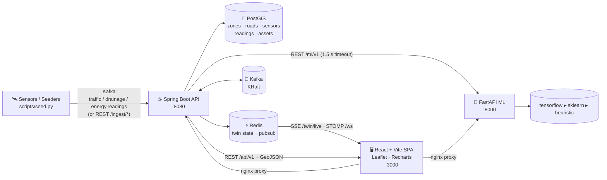

# 🌆 UrbanTwin — Smart Urban Infrastructure & Digital Twin Platform

<p align="center">
  
  
  
  
  
</p>

UrbanTwin is a **full-stack digital twin for a city**: it ingests live sensor
telemetry for traffic, drainage, electricity, waste and road assets, forecasts
what happens next with an ML microservice (with physics fallbacks), serves it
all on a live OSM map, and — the flagship feature — **simulates cross-system
failure cascades**, e.g. *“a substation outage blacks out drainage pumps,
which flood a corridor, which jams traffic, which triggers citizen reports.”*

Every subsystem ships working end-to-end: Dockerized infrastructure, Spring
Boot REST + Kafka + STOMP/SSE streaming, a Python ML service that auto-selects
TensorFlow → scikit-learn → pure-python heuristics, a 9-page React console and
one-command deployment to Docker or Kubernetes.

---

## Modules

| # | Module | What it does |
|---|--------|-------------|
| 1 | **Traffic + congestion prediction** | Live sensor readings, ML 5-minute congestion forecast per zone, hotspot firehose |
| 2 | **Roads & maintenance** | Condition-scored road network, maintenance request lifecycle (create → assign → resolve) |
| 3 | **Drainage & waterlogging** | Gauge levels, rainfall narrative, waterlogging risk prediction with affected roads |
| 4 | **Electricity** | Grid load curves, voltage sag, live outage reporting & recovery |
| 5 | **Waste route optimization** | Bin fill-level prioritization, nearest-neighbour route optimizer with distance/duration |
| 6 | **Emergency route optimization** | Incident dispatch to safest/fastest corridor with ETA ranking |
| 7 | **GIS engine** | GeoJSON feature layers (zones, roads, sensors, bins, assets, incidents, vehicles, grids) + congestion heatmap |
| 8 | **Digital twin dashboard** | KPIs, live status ticker over SSE/STOMP, city map overlay |
| 9 | **Cascade simulation (flagship)** | 4 failure scenarios that propagate across systems with delays & probabilities — animated timeline + DAG |
| 10 | **Alert Center** | threshold engine over every live feed (traffic / drainage / energy / waste / roads) with severity cards + CSV export |
| 11 | **White/Black theming** | persistent light/dark toggle — white by default, all maps & charts recolor |
| 12 | **PWA manifest** | installable standalone window with brand colors |

## Architecture



**Contracts over conventions** — everything (ports, REST paths, DTO shapes,
Kafka topics, ML request/response bodies) is pinned in
[`docs/CONTRACT.md`](docs/CONTRACT.md); components are only coupled through it.

## Quickstart (one command)

```bash
docker compose up --build
```

Wait ~60 s for the API to boot and seed the Dhaka demo dataset
(8 zones, 40+ roads, 60 traffic sensors, 48 h of readings, drainage gauges,
grids, bins, incidents, vehicles…), then open:

| URL | What |
|---|---|
| **http://localhost:3000** | the twin console (9 pages) |
| http://localhost:8080/api/v1 | REST API — try `/twin/state` |
| http://localhost:8080/swagger-ui.html | interactive OpenAPI docs |
| http://localhost:8000/docs | ML service (FastAPI) |

### Keep data flowing

The seeder pushes live, diurnal-patterned telemetry through the REST ingest
bridge — storms roll in, grids sag, congestion builds at rush hour:

```bash
python scripts/seed.py --api-url http://localhost:8080   # stdlib, no deps
```

Watch it on the Overview page: KPIs and the map recolor in (near) real time
via `/api/v1/twin/live` (SSE) and `/ws` (STOMP).

> **Already ran an older version?** The seeded city changed Bengaluru →
> **Dhaka**. The seeder skips when data exists, so recreate the volume once:
> `docker compose down -v && docker compose up --build`.

### Dashboard look & theme

The console boots in a clean **WHITE (light)** theme; the topbar 🌙/☀️ button
switches to the **BLACK (dark)** theme — the choice is remembered per browser.
All charts, maps and the cascade graph recolor with it.

### 60-second demo tour

1. **Overview** — KPI cards + zone polygons colored by live congestion.
2. **Traffic** — flip *current → +30 min prediction*; hotspots shift as the ML
   forecast pulls toward the model curve.
3. **Drainage** — with the seeder's storm active, waterlogging predictions
   turn `moderate → high`, affected roads are listed.
4. **Waste** — hit *Optimize route*: bins ranked by fill level are chained
   into a route, drawn on the map with length + duration.
5. **Emergency** — dispatch an incident: the planner ranks vehicles by ETA.
6. **Simulation** — run `water_main_burst`: the cascade graph animates node by
   node (drainage → roads → traffic), with impact summary totals.

## ML service — graceful 3-tier degradation

```
tensorflow (keras artifacts)  ▸  scikit-learn (joblib GBR)  ▸  pure-python physics
```

The Java `MlClient` times out after 1.5 s; if the ML service is slow, missing
or unreachable, identical heuristics inside the backend take over — responses
carry the `backend` / model marker they were served by. `/ml/v1/health`
reports the active tier. Retrain any time:

```bash
cd ml-service && python train.py   # synthetic labels from the physics heuristics
```

## Tests

| Suite | Command | Status |
|---|---|---|
| Backend (JUnit 5) | `mvn -B verify` (in `backend/`) | 7/7 ✅ |
| ML service (pytest) | `pytest -q` (in `ml-service/`) | 10/10 ✅ |
| Frontend (tsc + vite) | `npm run build` (in `frontend/`) | ✅ |

CI runs all three on GitHub Actions (`.github/workflows/ci.yml`), each only
when its own paths change.

## Kubernetes

```bash
kubectl apply -f deploy/k8s
```

PostGIS StatefulSet, Redis, Kafka (KRaft), API/ML/Web Deployments with
probes, NodePort `:30300` + optional Ingress — see
[`deploy/k8s/README.md`](deploy/k8s/README.md).

## Repository layout

```
backend/          Spring Boot 3.3.5 (Java 17) — REST, Kafka, STOMP/SSE, PostGIS
  src/main/java/com/urbantwin/
    traffic/ drainage/ energy/ waste/ emergency/ roads/ gis/ simulation/
    reports/ city/ ingest/ ml/ twin/ common/                  # 9 modules + shared
ml-service/       FastAPI forecasting service (TF ▸ sklearn ▸ heuristic)
frontend/         React 18 + Vite + TS — 9-page twin console + Leaflet maps
docs/             CONTRACT.md (authoritative interface spec)
deploy/k8s/       Kubernetes manifests + README
scripts/seed.py   live telemetry seeder (stdlib only)
docker-compose.yml  one-command full stack
```

## Documentation

- [`docs/CONTRACT.md`](docs/CONTRACT.md) — the binding API/data contract
- [`docs/ARCHITECTURE.md`](docs/ARCHITECTURE.md) — component deep-dive & data flow
- [`docs/API.md`](docs/API.md) — endpoint reference with example payloads
- [`docs/DATA_MODEL.md`](docs/DATA_MODEL.md) — entities, geoms, Kafka topics
- [`docs/SIMULATION.md`](docs/SIMULATION.md) — the cascade engine scenario catalogue

---

 MIT licensed — built as a systems-portfolio project: contract-first design,
failure-tolerant inference, and a one-command demo you can actually run.
